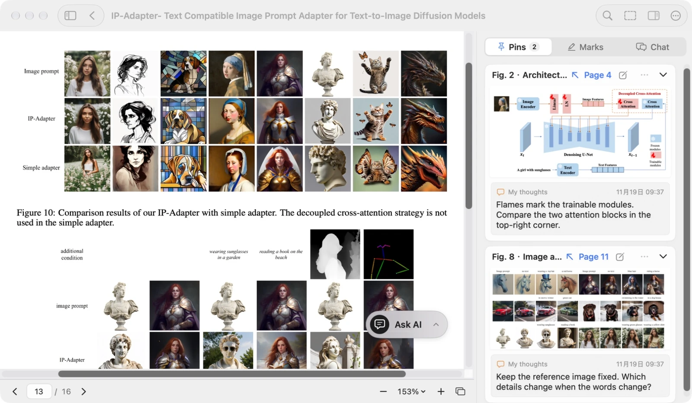
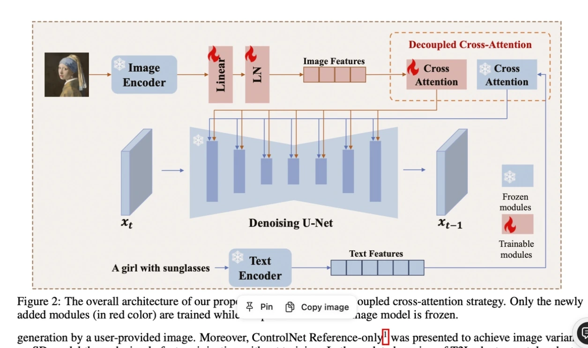
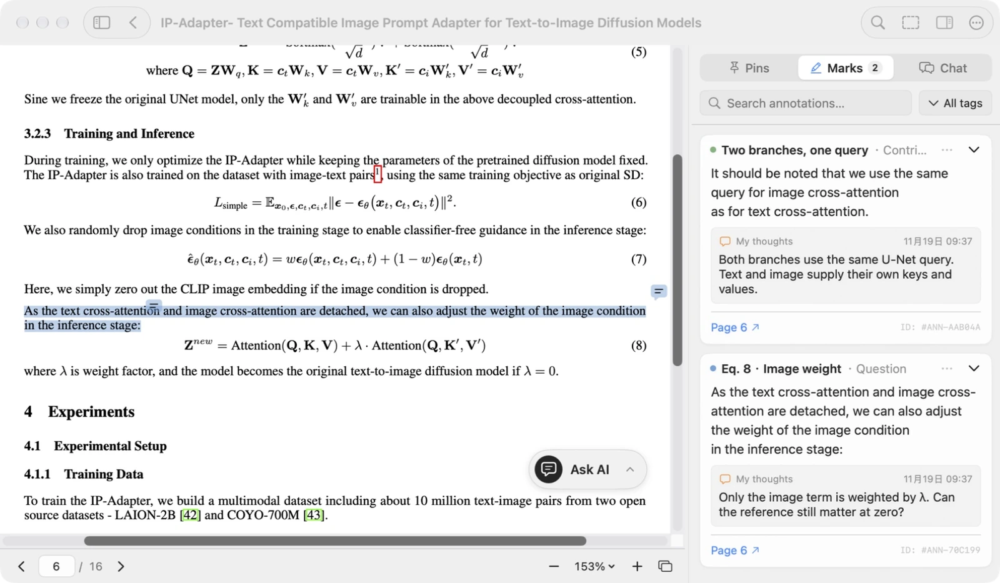
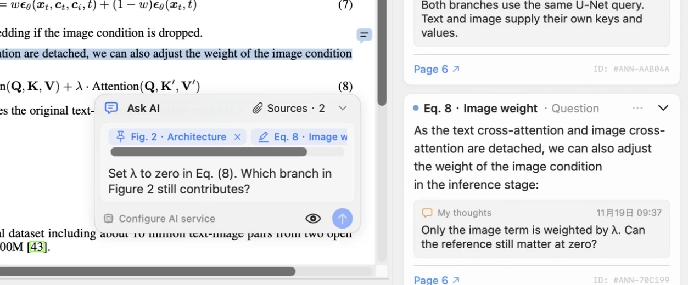

# Folio

[简体中文](README.md) · **English**

On page 13 of *IP-Adapter*, the authors put two adapters’ results side by side. The diagram that explains the difference is nine pages back. In Folio, you can pin Figure 2 from page 4, turn to Figure 10, and read the experiment with the architecture still in view.

Folio is a native macOS PDF reader for research papers. Keep figures beside the text, annotate passages, ask questions with a figure and a quote attached, and export your notes to Markdown.

**v1.0.1** · Apple Silicon · macOS 14 or later · English and Simplified Chinese

[Download for Mac](https://github.com/lokiwizard/folio/releases/download/v1.0.1/Folio-arm64.zip) · [Watch the 19-second demo](https://github.com/lokiwizard/folio/releases/download/v1.0/folio-ip-adapter.mp4) · [English subtitles (SRT)](docs/media/folio-ip-adapter.en.srt) · [Open the exported notes](docs/examples/ip-adapter/notes.en.md)

[](https://github.com/lokiwizard/folio/releases/download/v1.0/folio-ip-adapter.mp4)

## Reading IP-Adapter in Folio



*Click the blue page number on either card to jump back to the original figure.*

### Take the architecture with you

In the upper-right corner of Figure 2, two cross-attention blocks sit side by side. One has a flame, the other a snowflake. Which one gets trained? Use the dashed rectangle in the toolbar to select the diagram, then click **Pin** beside the selection. Give the card a name you’ll recognize later, such as “Figure 2 · Architecture.”



For a lab meeting, open the pinned image, draw an arrow to the new branch, and type a label next to it. **Copy Image** includes those edits.

### Leave a question beside equation (8)

On page 6, λ multiplies the image-attention term. Highlight the sentence above the equation, tag it **Question**, and add a comment of your own. “If λ is zero, can the reference image still affect the result?” Searching the card title brings back the passage, page number, and question together.



### Ask with the evidence attached

Drag the architecture card onto **Ask AI** and release when the capsule says **Drop here**. Drag the page 6 annotation into the same composer. You can now ask, “When λ is zero in equation (8), which branch in Figure 2 still contributes?” Click the eye to inspect the outgoing message. It includes the original PDF crop and the highlighted passage. Your comments and pen marks stay on your Mac.



After you send, the sidebar shows **Thinking**, then displays the reply as it arrives. The demo shows both states, with output from a local Gemma model sped up for the edit.

### Close the paper and keep the notes

Choose **File → Export Markdown notes…**. In this example, the two passages are grouped under **Question** and **Contribution**, and both figures have captions, page numbers, and comments. Keep the Markdown file and its image folder together when sharing them. [Read the exported IP-Adapter notebook](docs/examples/ip-adapter/notes.en.md)

The paper and figures are from *IP-Adapter: Text Compatible Image Prompt Adapter for Text-to-Image Diffusion Models* by Hu Ye, Jun Zhang, Sibo Liu, Xiao Han, and Wei Yang. The card names, comments, and question were written for this walkthrough. [Paper on arXiv](https://arxiv.org/abs/2308.06721)

## Install and open a paper

1. Download and unzip [Folio-arm64.zip](https://github.com/lokiwizard/folio/releases/download/v1.0.1/Folio-arm64.zip). If you build from source, the app is in `dist/Folio.app`.
2. Drag `Folio.app` into **Applications** in Finder and open it. Quit any earlier version before updating. If your older copy has a Chinese filename, rename it to `Folio.app` before replacing it. Your settings and reading history carry over.
3. Press **⌘O** or drop a PDF into the window. Reopen it later from **Recently opened**. For an encrypted PDF, enter the document password when prompted.

Reading, annotation, math rendering, and export work offline. Configure an AI service when you want to ask a question. The distributed build is ad hoc signed. If macOS asks you to confirm the developer on first launch, verify where you obtained the app and follow Apple’s instructions for **System Settings → Privacy & Security**. [Apple’s guide to opening apps on Mac](https://support.apple.com/en-us/102445)

## Quick reference

<details>
<summary>Reading, highlighting, and pinned figures</summary>

### Find your place

| Task | How |
| --- | --- |
| Navigate | Switch between thumbnails, outline, and bookmarks in the left sidebar. **⌘L** jumps to a page and **⌘D** bookmarks your place. After following a figure or citation link, **⌘[** takes you back. |
| Adjust the view | The bottom bar offers continuous or single-page reading, fit to width, fit to page, and rotation. Zoom with **Control + scroll**. Use the arrows, Space, or Page Up/Down to scroll, Home/End to jump, and **⌃⌘F** for full screen. |
| Search and select | **⌘F** searches the PDF text layer. Drag across text and click **Highlight** beside the selection. Use the rectangle tool for figures, equations, or a scanned page. |
| Find an annotation | In **Marks**, search by passage, card name, or comment, or filter by tag. Click a page number to revisit the passage, **Show full text** to expand it, or the pencil to comment. |
| Remove a highlight | Click the marked passage and choose **Remove highlight**. Deleting its sidebar card also clears the mark on the page. **Undo** restores the highlight, tag, and comment together. |
| Read existing highlights | Standard highlights made in other PDF readers enter the default category. You can retag, comment on, or delete them. The built-in **Limitation**, **Question**, **Contribution**, **Writing reference**, and **Default** tags have distinct colors. Adjust them in **Settings → Semantic highlights**. |
| Set up the workspace | With the left sidebar closed, drag the right divider as far as the center for an even split. Folio remembers the two-pane proportion and the three-pane sidebar width independently. **Settings → Appearance** controls light, dark, or system appearance and glass strength. Use the globe on the library screen or the reader’s More menu to switch languages. |

### Work with figure cards

- **Organize.** Drag a card up or down to reorder it. Hold it near the top or bottom to scroll the list. To delete it, move the pointer to the pale red strip along the right edge and release. Move back to keep sorting, press Esc to cancel, or click **Undo** after deletion.
- **Customize.** Collapse a card with its disclosure arrow. Use **…** to rename it or adjust its scale from 80% to 200%. Pinned figures also support custom colors. The paper remembers your names, order, colors, and comments.
- **Size the comments.** Under **Settings → Appearance → Comment font size**, choose 10–32 pt (default 14 pt). Comments reflow as the sidebar changes width, and their text keeps the size you chose.
- **Mark up a figure.** Open its preview to draw with a pen, line, rectangle, ellipse, or arrow. Change the color, line width, or dash style. The hand tool selects each new object so you can move it, resize a shape, rotate a rectangle, or drag an arrow’s endpoints.
- **Add text.** Type inside a selected rectangle or ellipse, or choose the text-box tool and drag out a separate box. Drag the edges or corners to resize, set the font size in the options bar, and move the box by its border. **Control + scroll** zooms the image while you edit. Press **⌘Return** to finish and double-click to edit again.
- **Copy and undo.** Use **Copy Image** in the editor or right-click the card preview. Copies and exported figures include your markup. Delete removes the selected object, **⌘Z** undoes, **⇧⌘Z** redoes, and **⌘0** fits the whole image.

</details>

<details>
<summary>AI services, questions, and conversations</summary>

Open **Settings → AI services**, choose a provider, enter the API key, and click **Fetch models**. Choose a model returned for your account, then click **Save and use**. You can enter a model or endpoint ID manually when the provider has no model directory. **Test connection** sends a short message. Multiple saved configurations can coexist.

Folio supports OpenAI, Anthropic, Google Gemini, DeepSeek, Alibaba Cloud, Moonshot, Zhipu, Volcengine Ark, and custom HTTPS Chat Completions endpoints. Folio encrypts saved keys using this Mac’s Secure Enclave. A saved key is available after relaunch; configure it again on another Mac. The provider bills usage to the API account you choose.

| Ask about | How |
| --- | --- |
| The whole paper | Open **Ask AI**, select the full-paper scope, and type a question. A new chat starts with five suggested questions. Use **Prompts** to add, edit, or remove as many as you like, including all of them. The list is shared across papers and persists after relaunch. Clicking a prompt fills the composer so you can edit it before sending. |
| A passage | Select text and click **Ask AI**. The composer displays the full quotation. Choose **Explain**, **Translate**, or **Summarize**, or write your own question. Each selection joins the current conversation. You can also include the current page. |
| One or more cards | Drag cards onto the collapsed capsule or open composer. A compact preview shows the drop position. A mark contributes its source text, and a figure contributes its original crop, with title and page. Figure questions require a model that accepts images. |

The composer can be moved or collapsed. Preview the destination and content before sending. Replies stream into the right sidebar with bold text and LaTeX rendering. Stop generation whenever you like, scroll back while it runs, or click a point on the timeline to jump to a turn. Each paper has its own history. Use **+** to start a chat, the history menu to switch, the trash button to delete a conversation, or the question’s context menu to delete a single exchange.

</details>

<details>
<summary>Markdown, page extraction, and local data</summary>

- **Export a notebook.** In **File → Export Markdown notes…**, choose a destination. Folio groups passages by tag and includes page references, titles, comments, and figures. Image links are relative. Share the Markdown file together with its matching `figures-…` folder.
- **Extract or print pages.** In **File → Extract Pages as PDF…**, enter a range such as `5, 1–3` to export pages 5, 1, 2, and 3 in that order. Duplicate page numbers are included once. Extracted pages retain the source PDF content and embedded annotations. Extracting from an unlocked encrypted document produces a PDF without a password. **⌘P** prints the document; the More menu also prints the current page.
- **Resume reading.** Reading position, zoom, rotation, bookmarks, cards, and conversations are stored under `~/Library/Application Support/页间/`. Open the same PDF to continue. Folio saves annotation edits in its local reading record and preserves the original file.

</details>

## Build and test

Folio uses Swift, SwiftUI, AppKit, and PDFKit. Page thumbnails and figure previews render on demand in the background. Each paper’s figure-preview cache is configured for up to **50 entries** with a **16 MiB** memory budget. KaTeX and qpdf ship with the app.

On an Apple Silicon Mac with Xcode and the macOS SDK installed, run this from the repository root.

```sh
./Scripts/build.sh
```

The script produces `dist/Folio.app` and `dist/Folio-arm64.zip`. It uses an ad hoc signature by default. Set `FOLIO_SIGN_IDENTITY` to use your signing certificate.

Run the native-window regression suite in an unlocked macOS session so the test window can receive mouse and keyboard input. Supply a text-based PDF with at least three pages containing the English word `the`, followed by a longer, illustrated PDF.

```sh
./Scripts/verify.sh "/path/to/paper.pdf" "/path/to/long-illustrated-paper.pdf"
```

Tests use a temporary profile to exercise selection, scrolling, drag and drop, typing, deletion, and undo. They check saved state after reopening, exported Markdown figures, and extracted pages. Local test fixtures cover AI protocol handling and streaming. Use **Test connection** to check a real provider account. A separate process measures long-document paging and release of document resources.

<details>
<summary>Performance measurements for v1.0</summary>

Measured on November 19, 2026, using an Apple M5 Mac with 24 GB of memory, macOS 27.0.1, and an optimized arm64 build. Startup used the 16-page IP-Adapter paper. Paging used a 62-page illustrated survey.

| Measurement | Result |
| --- | --- |
| Distribution size | 3.28 MiB ZIP, including offline math rendering and page extraction. |
| Open a paper | 1.14 seconds from starting the verification process to readable text on the first page, with the filesystem cache available at the time. |
| Rapid paging | Rendering all 62 pages with at least 60 ms per page reached a sampled peak of 739.2 MiB RSS and 694.0 MiB physical footprint. |
| Idle and close | Over five idle seconds, CPU usage was 0.05% of one core. Across four alternating open-and-close cycles, the document and its view were released within 0.60–0.75 seconds. |

The memory figures include PDFKit page analysis and rendering. Weak references were used to verify that the document and its view were released after close.

</details>
