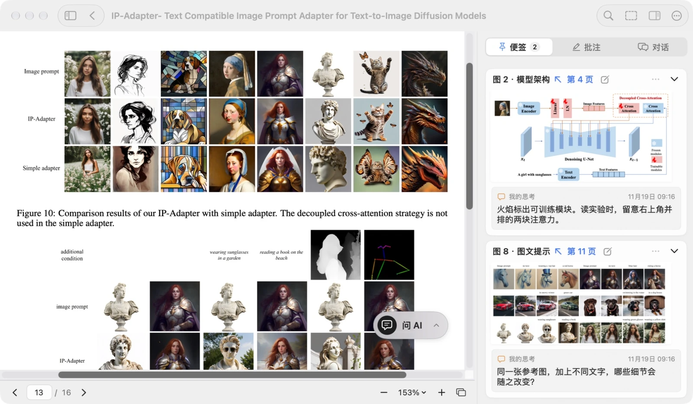

# Folio

**简体中文** · [English](README.en.md)

读到 IP-Adapter 第 13 页的消融实验，想回第 4 页看一眼模型图？在 Folio 里，可以把图 2 钉在右栏，再翻到图 10。一边是两条注意力分支，一边是两种适配器生成的图像。论文里相隔九页的两张图，现在就在一起。

Folio 是一款原生 macOS 论文阅读器，支持图表便签、带备注的高亮、引用原文和图像的 AI 问答，以及 Markdown 笔记导出。

**v1.0.1** · Apple Silicon · macOS 14 及以上 · 简体中文 / English

[下载 Mac 版](https://github.com/lokiwizard/folio/releases/download/v1.0.1/Folio-arm64.zip)　·　[看 19 秒操作演示（MP4）](https://github.com/lokiwizard/folio/releases/download/v1.0/folio-ip-adapter.mp4)　·　[看这次导出的笔记](docs/examples/ip-adapter/notes.md)

[](https://github.com/lokiwizard/folio/releases/download/v1.0/folio-ip-adapter.mp4)

## 跟着 IP-Adapter 读一遍



*两张便签分别来自第 4 页和第 11 页。点便签上的蓝色页码，就能回到原图。*

### 把第 4 页的架构图带到后面

图 2 右上角并排画着两个 Cross Attention 模块，一边标着火焰，一边标着雪花。读到后面的实验，很容易忘了哪边参与训练。在右上角打开虚线框选工具，框住整张图，点选区旁的「固定」。给便签起名「图 2 · 模型架构」，就可以接着往下读了。


如果要在组会上讲这张图，点开便签预览，就能用箭头指出新加的分支，在旁边写几个字。「复制图片」会把自己的标记一起带走。

### 在公式（8）旁，留一个下次还看得懂的问题

第 6 页的公式（8）里，λ 只乘在图像注意力那一项上。把公式上面讲推理权重的原句标成「疑问」，再写一句自己的话：“如果 λ 取 0，参考图还能影响生成吗？”下次搜「图像权重」，就能找回原句、页码和当时卡住的地方。


### 把图和原文一起放进问题里

把第 4 页的架构图便签拖到「问 AI」胶囊上，看到「松开引用」后松手；再把第 6 页的批注拖进同一个提问框。现在可以直接问：“如果把式（8）的 λ 设为 0，图 2 里的哪条分支还在起作用？”点眼睛图标可以核对要发送的内容。图表引用使用 PDF 裁图，批注引用使用论文原文，个人备注和手绘标记留在本机。


发送后，右栏先显示「思考中」，随后逐段显示回答。短片保留了这两个界面状态，本机 Gemma 的实际输出已按片长加速。

### 合上 PDF，把读过的东西带走

在「文件 → 导出 Markdown 笔记…」里选一个位置。打开这次的成品，可以看到两条批注按「疑问」「核心创新」分组，两张便签带着图像、页码和备注。把 Markdown 和配图目录放在一起，就可以继续写组会提纲。[查看 Folio 导出的 IP-Adapter 精读笔记](docs/examples/ip-adapter/notes.md)

示例使用 Hu Ye、Jun Zhang、Sibo Liu、Xiao Han 和 Wei Yang 的论文 *IP-Adapter: Text Compatible Image Prompt Adapter for Text-to-Image Diffusion Models*。截图及短片中的论文图表来自原作，中文卡片名、备注和提问是本次演示的阅读笔记。[论文原文（arXiv）](https://arxiv.org/abs/2308.06721)

## 安装与首次打开

1. 下载并解压 [Folio-arm64.zip](https://github.com/lokiwizard/folio/releases/download/v1.0.1/Folio-arm64.zip)。源码构建完成后，也可以在 `dist` 中找到 `Folio.app`。
2. 在访达中将 `Folio.app` 拖入「应用程序」，双击打开。更新前请先退出旧版。如果旧版使用中文文件名，可以把它改名为 `Folio.app`，再用新版替换。原有设置和阅读记录会自动沿用。
3. 按 **⌘O** 选择论文，或把 PDF 拖进窗口。下次可从「最近打开」继续阅读。加密 PDF 按提示输入文档密码。

安装包已包含公式排版和 PDF 摘页组件。阅读、批注和导出可离线使用，AI 服务可在需要提问时再配置。当前分发包使用本机临时签名。如果 macOS 在首次打开时提示无法验证开发者，确认文件来源后，可按苹果的指引在「系统设置 → 隐私与安全性」中允许打开该应用。[Apple 安装提示说明](https://support.apple.com/zh-cn/102445)

## 操作速查

<details>
<summary>阅读、批注与图表便签</summary>

### 阅读与批注

| 想做什么 | 怎么操作 |
| --- | --- |
| 翻页与定位 | 在左栏切换页面缩略图、目录和书签。按 ⌘L 输入页码，按 ⌘D 收藏当前位置。点击文内图表或参考文献链接后，按 ⌘[ 返回。 |
| 调整阅读视图 | 底栏可切换连续滚动、单页翻阅、适合页宽或整页，也可旋转当前页。Ctrl 加滚轮缩放，方向键、空格和 Page Up / Page Down 滚动，Home / End 跳到首页或末页。按 ⌃⌘F 切换全屏。 |
| 查找与摘录 | 按 ⌘F 搜索 PDF 文字层，逐项查看匹配。指向正文时，鼠标变为工字形，可拖选跨行文字，复制或在选区旁点「高亮」。截取图表或扫描页时，点右上角的虚线矩形，用十字指针框选。 |
| 整理高亮 | 右栏「批注」支持按原文、卡片名或备注搜索，也可按标签筛选。点页码回到出处，点「展开全文」阅读长摘录，点铅笔添加个人备注。 |
| 取消高亮 | 单击正文中已高亮的文字，在旁边点「取消高亮」，对应的批注卡片也会移除。在右栏删除批注同样会清除正文高亮。误删后点「撤销」可一起恢复高亮、标签和备注。 |
| 沿用已有批注 | 其他阅读器写入 PDF 的标准高亮会自动归入默认标签，可改标签、写备注或删除。预置的「局限」「疑问」「核心创新」「写作参考」「默认」各有不同颜色，在「设置 → 语义高亮」中可调整标签和默认类别。 |
| 调整界面 | 收起左栏，将右栏分隔线向左拖到窗口中央，正文和右栏即可各占一半。窗口大小改变时会保持你选的比例。展开左栏后，可以单独调整三栏布局的宽度。「设置 → 外观」可切换浅色、深色或跟随系统，并调节毛玻璃强度。首页地球按钮和阅读窗口的更多菜单可切换中英文。 |

### 图表便签与卡片整理

点右上角的虚线矩形，框出模型图、表格或公式，在选区旁点「固定」。图像会留在右栏「便签」中，可以命名为「系统框图」或「伪代码」。点预览图进入大图编辑器，点卡片页码回到图表所在页。

- **排序与删除**　按住便签或批注卡片拖动，上下移动可调整顺序。靠近列表顶边或底边会自动滚动。向右拖，让指针进入侧栏右边缘的淡红色区域，出现「松开删除」后松手。松手前移回列表可继续排序，按 Esc 可取消整次拖动。误删后点侧栏的「撤销」，卡片会回到原位置。
- **卡片外观**　点箭头折叠内容，用「…」重命名或调整卡片大小（80% 至 200%）。便签还可自选底色。卡片名称、顺序、颜色和备注会随论文保存。
- **备注字号**　在「设置 → 外观 → 备注字号」中可选 10–32 pt，默认 14 pt。便签、批注和备注编辑框共用这个字号。拖宽或收窄侧栏时文字按可用空间换行，卡片缩放也会保留所选字号。
- **标注图片**　用画笔、直线、矩形、椭圆或箭头在图上标记，可改色、线宽和虚实。画完自动切回手型并选中对象。拖对象可移动，拖矩形角点可调整尺寸，拖圆柄可旋转，拖箭头端点可改变长度和方向。
- **输入文字**　选中矩形或椭圆可直接打字。单独标文字时，选「文本框」，拖出范围即可输入。四边分别调宽或调高，四角可同时调两个方向，字号在属性栏单独调整。输入时也可拖边框移动或按 Ctrl 加滚轮缩放。按 ⌘Return 完成，双击可继续编辑。
- **复制与撤销**　在大图中点「复制图片」，或右键点击卡片预览图复制。复制和导出的图片包含本地画上的标记。在编辑器中按 Delete 删除选中对象，⌘Z 撤销，⇧⌘Z 重做，⌘0 恢复全图。

</details>

<details>
<summary>AI 服务配置、提问方式与聊天记录</summary>

**配置模型**　打开「设置 → AI 服务」，选择厂商，填入 API Key，点「获取模型」并从账号返回的列表中选择，再点「保存并使用」。如果厂商不提供模型目录，可填写模型或推理接入点 ID。「测试连接」会发送一条短消息。可保存多组配置，按需切换。

支持 OpenAI、Anthropic、Google Gemini、DeepSeek、阿里云百炼、月之暗面、智谱、火山方舟，以及提供 HTTPS Chat Completions 接口的自定义服务。密钥通过这台 Mac 的安全隔区加密保存，重开应用仍可使用。换到另一台 Mac 时需重新配置。用量由所选 API 账户结算。

| 提问方式 | 操作 |
| --- | --- |
| 问全文 | 点页面上的「问 AI」，选择全文范围后输入问题。右栏「对话」里的新对话也提供五个初始问题。点右上方的「提示词」可以添加、改写或删除问题，数量不限，也可删空。保存后所有论文共用这份列表，重新打开应用仍会保留。点选问题会填入提问框，编辑后即可发送。 |
| 问一段话 | 选中文字后点「问 AI」。浮窗中可查看完整引文，点「解释」「翻译」或「总结」填入问题，也可自己写。新选区会接入当前对话，按需附加当前页。 |
| 问一张图或多张卡片 | 把右栏卡片拖向问答胶囊或已展开的提问框。卡片会缩成指针旁的小图，看到「松开引用」后松手即可添加。批注引用原文，图片便签引用 PDF 原始裁图，附上相应标题和页码。卡片里的个人备注与手绘标记留在本机。图片问答需要所选模型支持视觉输入。 |

浮窗可拖动和收起。发送前可预览目标服务及引用内容，回答会逐步显示在右栏，支持加粗和 LaTeX 公式。生成时可以停止，也可向上滚动回看。点击对话右侧时间线上的圆点可跳到指定轮次。聊天记录按论文保存，用「+」新建，从历史菜单切换，用垃圾桶删除对话，或右键点击问题删除单轮问答。

</details>

<details>
<summary>Markdown 导出、摘页与本地数据</summary>

- **导出笔记**　在「文件 → 导出 Markdown 笔记…」中选择保存位置。导出的文档按标签整理摘录，保留页码、卡片名、备注及图表。配图使用相对路径，分享时把 Markdown 和同目录的 `figures-…` 文件夹一起带上。
- **摘页与打印**　选「文件 → 提取页面为 PDF…」，输入 `5, 1–3` 可按 5、1、2、3 的顺序生成新文件，重复页码只提取一次。摘页沿用源文件的内容和内嵌批注，解锁后的加密文档会导出为无密码 PDF。按 ⌘P 打印，也可从更多菜单直接打印当前页。
- **本地记录**　阅读位置、缩放、旋转、书签、卡片和对话保存在 `~/Library/Application Support/页间/`。重新打开同一份 PDF 即可继续阅读。Folio 对批注的编辑保存在阅读记录中，原 PDF 保持原样。

</details>

## 从源码构建与测试

项目使用 Swift、SwiftUI、AppKit 和系统 PDFKit。页面缩略图与便签预览按需在后台绘制。每篇论文最多缓存 50 项便签预览，内存预算为 16 MiB。KaTeX 和 qpdf 随应用打包。

在装有 Xcode 与 macOS SDK 的 Apple Silicon Mac 上，进入项目根目录执行以下命令。

```sh
./Scripts/build.sh
```

构建产物为 `dist/Folio.app` 和 `dist/Folio-arm64.zip`。脚本默认使用本机临时签名，有代码签名证书时可设置 `FOLIO_SIGN_IDENTITY`。

请在已解锁的 macOS 桌面运行原生窗口回归测试，让测试窗口接收鼠标和键盘输入。第一份样本应至少有三页、含文字层和英文单词 `the`，第二份使用页数较多的图文 PDF。

```sh
./Scripts/verify.sh "/路径/普通论文.pdf" "/路径/较长的图文论文.pdf"
```

脚本使用独立临时目录，模拟选区、滚动、拖放、键入、删除与撤销，并核对保存重开、Markdown 配图及摘页结果。AI 协议和流式输出使用本地样例验证，实际账号可在「AI 服务」中测试连接。长文档翻页与关闭后的资源释放在独立进程中测量。

<details>
<summary>查看 v1.0 的本机性能实测</summary>


2026 年 11 月 19 日，在 Apple M5、24 GB 内存、macOS 27.0.1 上使用 arm64 优化构建测量。打开样本为 16 页的 IP-Adapter 论文，翻页样本为 62 页图文综述。

| 项目 | 结果 |
| --- | --- |
| 安装包 | ZIP 3.28 MiB，含离线公式排版和摘页工具 |
| 打开论文 | 从启动新验收进程到首页出现可读正文为 1.14 秒，沿用当时的文件系统缓存 |
| 快速翻页 | 逐页绘制 62 页，每页停留至少 60 毫秒，进程 RSS 采样峰值 739.2 MiB，物理内存采样峰值 694.0 MiB |
| 空闲与关闭 | 打开长文档后空闲采样 5 秒，CPU 为单核的 0.05%。交替打开并关闭两篇论文共四次，均在 0.60 至 0.75 秒内释放文档和阅读视图 |

内存采样包含 PDFKit 的页面分析和绘制开销。测试另用弱引用检查文档与视图在关闭后释放。

</details>
