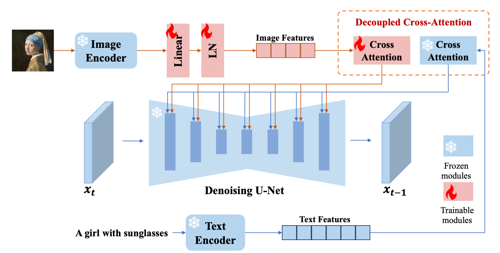
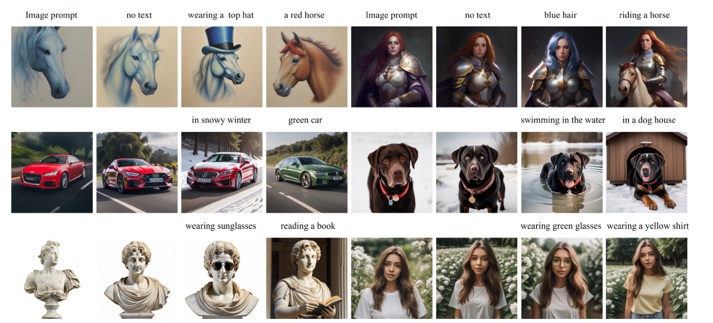

# IP-Adapter reading notes

Pages · 16   |   Annotations · 2   |   Clips · 2

## Notes

### Question

**Eq. 8 · Image weight** · *Page 6*

> As the text cross-attention and image cross-attention are detached, we can also adjust the weight of the image condition
> in the inference stage:

Only the image term is weighted by λ. Can the reference still matter at zero?

### Contribution

**Two branches, one query** · *Page 6*

> It should be noted that we use the same query for image cross-attention
> as for text cross-attention.

Both branches use the same U-Net query. Text and image supply their own keys and values.

## Pinned clips

### Fig. 2 · Architecture

*Page 4*

Flames mark the trainable modules. Compare the two attention blocks in the top-right corner.

### Fig. 8 · Image and text

*Page 11*

Keep the reference image fixed. Which details change when the words change?
