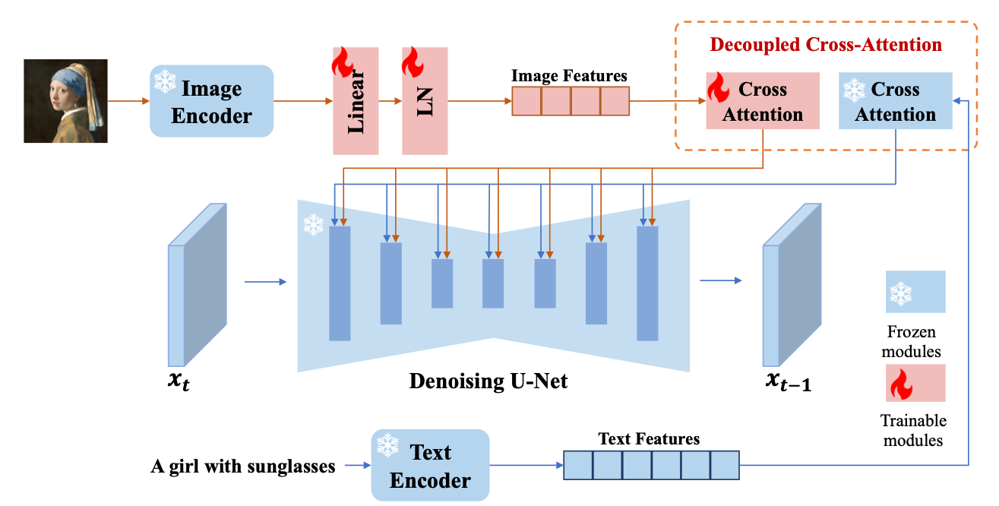
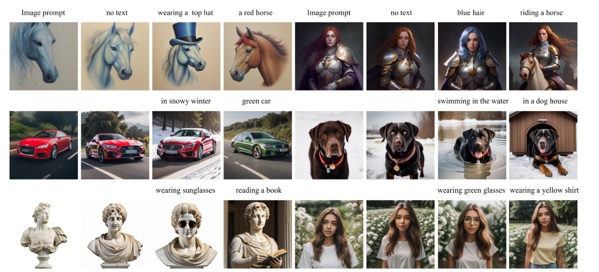

# IP-Adapter 精读笔记

16 页 · 2 条批注 · 2 张便签

## 批注

### 疑问

**式（8）· 图像权重** · *第 6 页*

> As the text cross-attention and image cross-attention are detached, we can also adjust the weight of the image condition
> in the inference stage:

λ 只乘在图像分支上。如果取 0，参考图还能影响生成吗？

### 核心创新

**两条分支共用 Q** · *第 6 页*

> It should be noted that we use the same query for image cross-attention
> as for text cross-attention.

回看图 2：两条分支都从同一份 U-Net 特征取 Q，图像和文字各自提供 K、V。

## 图表便签

### 图 2 · 模型架构

*第 4 页*

火焰标出可训练模块。读实验时，留意右上角并排的两块注意力。

### 图 8 · 图文提示

*第 11 页*

同一张参考图，加上不同文字，哪些细节会随之改变？
